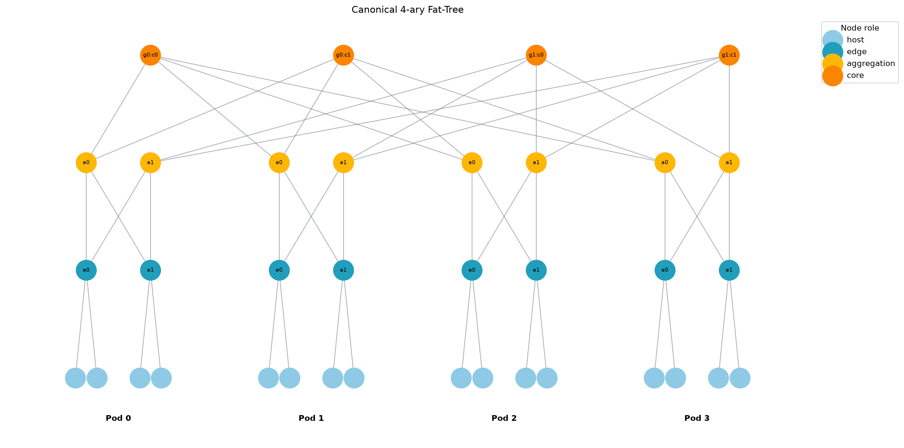
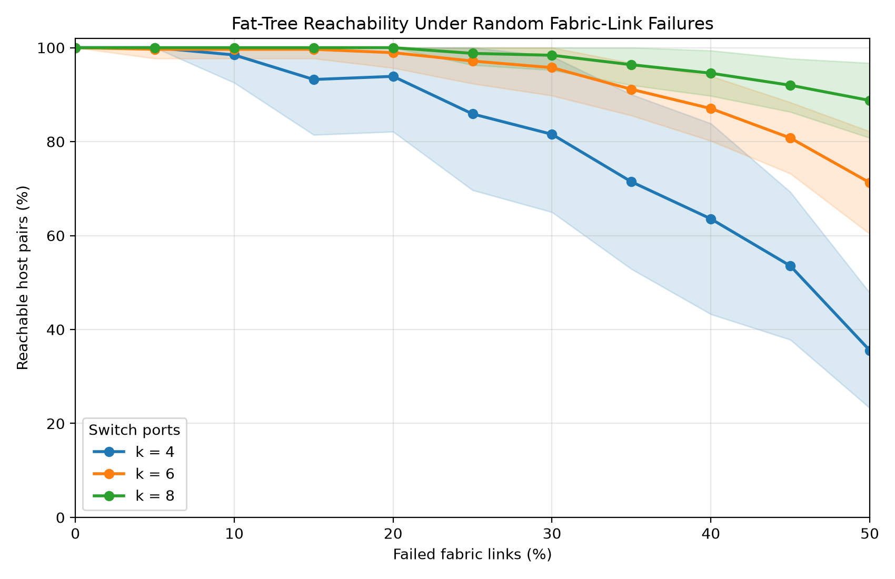
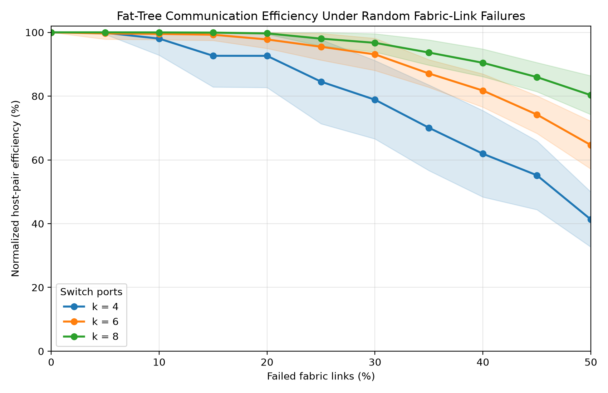

# Canonical k-Ary Fat-Tree: Generation and Robustness Analysis

This project constructs a canonical three-tier fat-tree data-center network, validates its structure, injects reproducible random link failures, and measures how failures affect host-to-host communication. The analysis asks:

> How does random fabric-link failure affect host-to-host communication efficiency and reachability as fat-tree size increases?

The experiment shows that larger fat-trees preserve substantially more communication under the same percentage of failed fabric links because they provide more redundant paths.

## Background

The implementation follows the topology in M. Al-Fares, A. Loukissas, and A. Vahdat, [*A Scalable, Commodity Data Center Network Architecture*](https://doi.org/10.1145/1402958.1402967), ACM SIGCOMM 2008. The paper uses a fat-tree to connect many hosts with identical commodity Ethernet switches while providing many equal-cost paths between pods.

A detailed summary of the homework and paper is available in [ASSIGNMENT_AND_PAPER_SUMMARY.md](ASSIGNMENT_AND_PAPER_SUMMARY.md).

## Topology Model

`k` is the number of ports on every switch. It must be an even integer greater than or equal to 2. Let `m = k / 2`.

### How the Three Tiers Work

The fat-tree is a hierarchy of three switch layers. Traffic moves upward only as far as necessary and then moves downward toward the destination:

1. **Edge tier:** Edge switches are the first and last network hop for hosts. Hosts attached to the same edge switch communicate through that switch without entering the higher tiers.
2. **Aggregation tier:** Aggregation switches join all edge switches inside one pod. Traffic between different edge switches in the same pod travels through one aggregation switch. Traffic for another pod continues upward.
3. **Core tier:** Core switches connect the pods. Traffic between hosts in different pods travels from the source edge to an aggregation switch, through a core switch, and then down through the destination aggregation and edge switches.

For example, host-to-host shortest paths contain 2 links under the same edge switch, 4 links between edge switches in the same pod, and 6 links between different pods.



*Figure: The canonical `k = 4` topology generated by this project. Hosts are leaves below the edge tier, and each repeated edge-aggregation group forms one of four pods. The structure follows the cited paper's Figure 3 while using shorter labels for readability.*

### Essential Terms

- **Port:** A physical or logical switch connection. In a `k`-ary fat-tree, every switch has `k` ports.
- **Pod:** A repeated building block containing `k/2` edge and `k/2` aggregation switches.
- **Fabric:** The switch-to-switch part of the network. In this project it consists of edge-aggregation and aggregation-core links.
- **Path:** A sequence of links connecting two hosts. Shortest-path length is the number of links in that sequence.
- **Equal-cost paths:** Different routes with the same shortest length. Their redundancy lets traffic avoid failed or congested links.
- **Oversubscription:** The ratio between offered host bandwidth and the bandwidth the network can carry in the worst case. A 1:1 design can theoretically serve all hosts at full rate simultaneously.
- **Bisection bandwidth:** The capacity available between two halves of the network. Fat-trees are designed to provide high bisection bandwidth when traffic is distributed across their paths.
- **Failure rate:** The percentage of eligible links removed in a trial.
- **Reachability:** The percentage of host pairs that still have at least one connecting path.

- The topology contains `k` pods.
- Each pod contains `m` edge switches and `m` aggregation switches.
- Each edge switch connects to `m` hosts and every aggregation switch in its pod.
- The core contains `m²` switches arranged as `m` groups of `m` switches.
- Aggregation switch `a` in each pod connects to all core switches in core group `a`.

The resulting counts are:

| Quantity | Formula |
|---|---:|
| Hosts | `k³ / 4` |
| Edge switches | `k² / 2` |
| Aggregation switches | `k² / 2` |
| Core switches | `k² / 4` |
| Total switches | `5k² / 4` |
| Total links | `3k³ / 4` |

Every host has degree 1, every switch has degree `k`, and the intact topology is connected. Hosts in different pods have `(k/2)²` equal-cost shortest paths.

Nodes use readable identifiers and role metadata:

- `host:p0:e1:h0`: host 0 below edge switch 1 in pod 0.
- `edge:p0:e1`: edge switch 1 in pod 0.
- `agg:p0:a1`: aggregation switch 1 in pod 0.
- `core:g1:c0`: position 0 in core group 1.

## Installation

Python 3.10 or newer is required.

```bash
python3 -m venv .venv
source .venv/bin/activate
python3 -m pip install -r requirements.txt
```

The only direct dependencies are NetworkX and Matplotlib.

## Implementation Libraries and Data Structures

- **NetworkX** stores the topology as an undirected `Graph`. Nodes carry metadata such as role, pod, and local index, while edges carry a layer label. The implementation also uses NetworkX for neighbor inspection, connectivity checks, and shortest-path distances.
- **Matplotlib** draws the topology and produces the reachability and efficiency plots. Experiment plots use its non-interactive `Agg` backend so they can be generated reproducibly without opening a window.
- **Python standard library** modules provide the remaining functionality: `argparse` for both command-line interfaces, `random.Random` for seeded failure sampling, `csv` and `pathlib` for result files, `statistics` for means and sample standard deviations, and `unittest` for verification.

The main data structure is a simple undirected graph because a physical link carries traffic in both directions and the model has at most one link between any two nodes. Sets are used when validating exact neighbor relationships, tuples preserve stable collections of links and pairs, and dictionaries hold node metadata and result rows. Immutable data classes package topology, failure, and metric results so values cannot be accidentally changed after calculation.

The implementation flow is: build and validate the intact graph, copy it, remove a seeded sample of eligible links, calculate all host-pair metrics, write one CSV row per trial, and aggregate the rows into the two plots.

## Topology CLI

Generate and validate a topology with:

```bash
python3 main.py --k 4
```

Available arguments:

- `--k K` - required even switch-port count, `K >= 2`.
- `--failure-rate PERCENT` - eligible links to remove, from 0 through 100; default `0`.
- `--failure-scope {all,fabric}` - `all` includes host links, while `fabric` includes only edge-aggregation and aggregation-core links; default `all`.
- `--seed INTEGER` - deterministic random seed.
- `--draw` - display the intact layered topology for `k <= 4`.

Example with 25% reproducible fabric-link failures:

```bash
python3 main.py --k 4 --failure-rate 25 --failure-scope fabric --seed 7
```

```text
Canonical 4-ary fat-tree
Pods: 4
Hosts: 16
Switches: 20 (edge=8, aggregation=8, core=4)
Links: 48
Validation: passed (connected; host degree 1; switch degree k)
Failure simulation:
  Requested rate: 25%
  Scope: fabric
  Seed: 7
  Eligible links: 32
  Removed links: 8
  Realized rate: 25.00%
  Removed by layer: aggregation-core=5, edge-aggregation=3
```

Failures are sampled uniformly without replacement. For `N` eligible links and rate `P`, the removed-link count is `floor(N × P / 100 + 0.5)`. Failure injection returns a damaged copy and preserves the intact graph.

## Robustness Metrics

The experiment examines every **unordered pair** among the `H` hosts. “Unordered” means that direction does not create a second pair: `(host A, host B)` and `(host B, host A)` describe the same communication relationship and are counted once. A host is never paired with itself. For example, three hosts `A`, `B`, and `C` produce exactly three pairs: `A-B`, `A-C`, and `B-C`.

Therefore, the number of distinct host pairs is:

```text
H(H - 1) / 2
```

host pairs.

### Reachability

Reachability is the percentage of host pairs for which a path still exists:

```text
reachable pairs / total pairs × 100
```

It directly measures fragmentation but does not distinguish short paths from long detours.

### Host-Pair Efficiency

For a reachable host pair at shortest-path distance `d`, the pair contributes `1/d`. A disconnected pair contributes zero:

```text
efficiency = sum(1 / distance) / total host pairs
```

The experiment divides damaged-network efficiency by the intact topology's efficiency for the same `k`:

```text
normalized efficiency = damaged efficiency / intact efficiency × 100
```

Normalized efficiency starts at 100%. It decreases when routes become longer or pairs become disconnected. This avoids a weakness of average path length: if distant pairs disconnect and are excluded, the average over only surviving pairs can misleadingly decrease.

This is an appropriate robustness metric because it combines connectivity and path quality in one value. The reciprocal `1/d` gives greater weight to short paths, penalizes longer detours, and assigns zero to a disconnected pair. Keeping disconnected pairs in the denominator prevents failures from appearing to improve the network merely because only short surviving paths remain. Normalizing against the intact topology gives every value of `k` the same 100% starting point, allowing a fair comparison of how much structural communication quality each topology retains.

## Experiment Design

The submitted experiment uses:

- `k = 4, 6, 8`.
- Fabric-link failure rates from 0% through 50% in 5% increments.
- 30 trials per `(k, failure rate)` configuration.
- Seeds 0 through 29.
- Edge-aggregation and aggregation-core failures only.
- 990 total trials.

Fabric-only failures isolate the effect of redundant network paths. Host-edge links have no alternative route, so including them would primarily measure direct host isolation rather than fabric robustness.

Reproduce the complete experiment with:

```bash
python3 experiment.py
```

The full command with explicit defaults is:

```bash
python3 experiment.py \
  --k-values 4 6 8 \
  --failure-rates 0 5 10 15 20 25 30 35 40 45 50 \
  --trials 30 \
  --seed-start 0 \
  --failure-scope fabric \
  --output-dir results
```

The command writes trial-level data to `results/robustness_metrics.csv` and generates both plots below. The line is the mean over 30 trials; the shaded band is one sample standard deviation.

## Results

### Reachability



Larger fat-trees maintain connectivity much longer. In the 30 sampled trials, `k = 8` retained 100% mean reachability through 20% failures, while `k = 4` had already fallen to 93.89% with much greater variation between failure samples.

### Communication Efficiency



Efficiency falls before or alongside reachability because surviving communication may require longer detours. At 30% failures, `k = 8` retained 96.71% mean normalized efficiency, compared with 93.09% for `k = 6` and 78.87% for `k = 4`.

Representative results are means plus or minus one sample standard deviation:

| `k` | Failure rate | Reachable pairs | Normalized efficiency |
|---:|---:|---:|---:|
| 4 | 20% | 93.89% ± 11.78% | 92.63% ± 9.94% |
| 6 | 20% | 98.93% ± 3.26% | 97.77% ± 2.82% |
| 8 | 20% | 100.00% ± 0.00% | 99.68% ± 0.26% |
| 4 | 50% | 35.56% ± 12.27% | 41.31% ± 8.63% |
| 6 | 50% | 71.26% ± 10.91% | 64.65% ± 7.50% |
| 8 | 50% | 88.76% ± 7.97% | 80.30% ± 6.07% |

The principal result is that robustness improves substantially with `k`. Increasing `k` creates more edge-to-aggregation choices and `(k/2)²` inter-pod core paths. Random failures are therefore less likely to remove every route between a pair of hosts.

The uncertainty bands are also meaningful. Small `k = 4` networks have fewer alternative links, so the exact failed-link sample strongly affects whether critical paths survive. Larger networks exhibit both higher mean robustness and lower relative sensitivity to an individual sample.

At severe failure rates, average path length among only reachable pairs must be interpreted carefully. For `k = 4`, it eventually decreases because many long-distance pairs have disconnected, leaving a larger proportion of short local pairs. Normalized efficiency still decreases because disconnected pairs contribute zero.

## Limitations

This experiment measures structural graph robustness. It does not simulate packet traffic, link capacity, congestion, TCP behavior, or the paper's two-level routing, flow classifier, and centralized flow scheduler. A connected path proves that communication is possible, not that it can achieve full bandwidth.

The failure model removes a fixed percentage of eligible links uniformly without replacement. It does not model correlated rack, switch, pod, or power failures. The conclusions therefore apply to independent random fabric-link failures under the stated model.

## Verification

Run all automated tests with:

```bash
python3 -m unittest discover -v
```

The suite checks:

- Reference sizes for `k = 4, 6, 8`.
- Exact node roles, degrees, pod-local wiring, and core connections.
- Detection of broken or cross-pod-swapped links.
- Failure input validation, scope filtering, rounding, copying, and seed reproducibility.
- Exact intact and disconnected `k = 4` metric values.
- Experiment input validation, deterministic CSV output, and plot creation.
- Command-line failure summaries.

## Project Layout

```text
main.py                           topology and single-failure-scenario CLI
fat_tree.py                       generator, failure injection, validation, drawing
analysis.py                       host-pair robustness metrics
experiment.py                     reproducible batch experiment and plotting CLI
tests/test_fat_tree.py             topology and failure tests
tests/test_analysis.py             metric and experiment tests
results/robustness_metrics.csv     trial-level experimental data
results/*.png                      generated result plots
ASSIGNMENT_AND_PAPER_SUMMARY.md    homework and cited-paper study notes
requirements.txt                   Python dependencies
```

## AI Assistance Acknowledgment

This implementation, experiment design, tests, plots, and documentation were developed with assistance from OpenAI Codex. The student remains responsible for reviewing and understanding all submitted material and accepts full responsibility for the submission.
